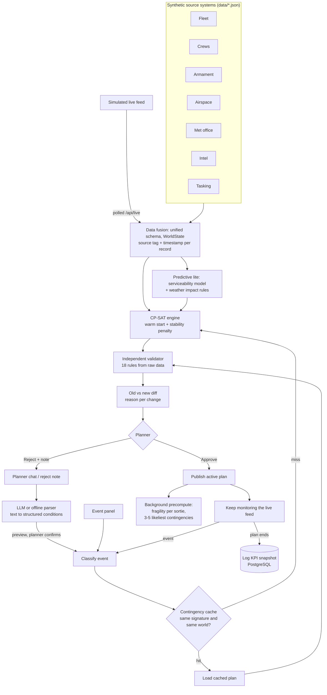

# Aeolus: project details

The full reference that used to live in the README: architecture, how each part works, measured results,
assumptions, known limitations and future scope. For the short overview, see the [README](../README.md).

> SYNTHETIC DATA. Every aircraft type, airframe, base, crew, weapon and number in this project is fictional
> and generated by `data/generate.py`. Nothing here is real military data.

## The problem

Information on aircraft availability, crew status, weapon loads, airspace, weather, threats and mission priorities is spread across separate systems. Without a common real-time picture, planning takes a long time and scarce airpower is not used as well as it could be, especially when things change mid-day.

## What Aeolus does

1. **Fuses** eight synthetic source systems (fleet, crew roster, armament, airspace, met office, intel, tasking, planning rules) into one live `WorldState`, with a source tag and timestamp on every record. A simulated live feed keeps updating it; dashboards poll `/api/live` every 2 s.
2. **Optimises** the assignment of aircraft + crew + weapons + take-off time to missions with Google OR-Tools CP-SAT, under hard constraints, with a priority-weighted objective and risk penalties.
3. **Replans in seconds** when an event happens. It warm-starts from the current plan, penalises every changed assignment so the plan stays stable, and **explains every change** with a reason built from facts.
4. **Checks every plan independently.** A separate validator re-reads the raw data and checks 18 rules. A plan with any violation cannot be published.
5. **Keeps the human in control.** Each proposal is shown as old vs new with reasons, and the planner approves or rejects it. A reject note becomes a new condition and the solver tries again.

## Architecture



If `docs/architecture.png` is present, it shows the same flow as a drawing.

| Module | What it does |
|---|---|
| `data/generate.py`, `backend/app/data` | Seeded synthetic dataset (same seed, same data) and loader |
| `backend/app/fusion` | Unified Pydantic schema, `WorldState`, reference checks, live-feed simulator |
| `backend/app/predict` | Logistic-regression serviceability model (trained on synthetic data), weather impact rules |
| `backend/app/solver` | CP-SAT engine, greedy baseline, stability metric, warm-start replanning |
| `backend/app/validator` | Independent rule checker. It does not import the solver |
| `backend/app/events` | Event types, classifier (category, severity, cache signature), apply-to-state |
| `backend/app/precompute` | Fragility score per sortie, contingency cache |
| `backend/app/llm` | Groq client (text to conditions, summary wording) and the offline rule-based parser |
| `backend/app/planning` | Orchestrator and plan state machine, deterministic explanations |
| `backend/app/kpi` | The 8 KPIs |
| `backend/app/api` | FastAPI routes, including the `/api/live` poll |
| `backend/db` | `schema.sql` and a small psycopg (v3) data-access layer in plain SQL |
| `frontend/` | Next.js planner dashboard (client-side, talks to the API over REST, live updates by polling) |

## Run it on Windows

**Prerequisites:** Python 3.11, 3.12 or 3.13 · Node.js 20+ · pnpm (`npm install -g pnpm`) · a PostgreSQL database (local, or free hosted such as Neon or Supabase). The database is optional: without it the app runs in memory and shows "DB offline".

```powershell
# 1. configure
Copy-Item .env.example .env      # then set DATABASE_URL, and optionally GROQ_API_KEY and LLM_MODEL

# 2. one-time setup: venv + Python deps, synthetic data, model training, DB tables, frontend deps
pnpm setup

# 3. start API (:8000) and dashboard (:3000) together
pnpm dev
```

Open <http://localhost:3000>.

Other scripts:

| Command | What it does |
|---|---|
| `pnpm dev:api` / `pnpm dev:web` | Start only the API or only the dashboard |
| `pnpm dev:clean` | Stop leftover Aeolus dev servers on the web and API ports (3000 and 8000) if `pnpm dev` says a port is busy |
| `pnpm db:init` | Create the PostgreSQL tables from `backend/db/schema.sql` |
| `pnpm seed` | Regenerate the synthetic data (`data/*.json`) |
| `pnpm train` | Retrain the serviceability model |
| `pnpm test` | Run the backend tests (pytest, 81 tests) |
| `pnpm lint` | ruff |
| `pnpm smoke` | Headless run of the demo scenario through the API. Asserts 0 violations and prints the KPI table. Add `--no-db` to skip the database, or `--llm` to use Groq for the chat step |

**LLM (optional).** Set `GROQ_API_KEY` and `LLM_MODEL` in `.env`. The model must be one your Groq key can see; `openai/gpt-oss-20b` and `qwen/qwen3.8-27b` were tested. Without a key, or if a Groq call fails, the chat uses the offline rule-based parser and the demo still works.

## The dashboard

A light, multi-page ops-room app. A collapsible sidebar (icon rail below 1280 px) and a top bar sit on every page. The top bar has the "SYNTHETIC EXERCISE DATA" banner, a Zulu scenario clock with play/pause and 1x / 10x / 60x speed, and a Planner / Commander view switch. Each page does one job, starts with a short "What to do here" tip and ends with a "Next" button.

| Page | What you do there |
|---|---|
| Home | Getting started checklist, the next step, headline results, a compact theatre map and flight board, the ops overview charts, **Run exercise** |
| Ops map | Fictional theatre: bases, target zones, threat rings, weather cells, restricted airspace, routes coloured by priority. Aircraft (ARROW-01, HAMMER-03, ...) move with the clock through taxi, airborne, on target, returning and complete. Click anything for details |
| Data and live feed | Ops charts (fleet readiness, coverage by priority, crew duty, weapons vs planned use, threat by zone over the day), tables for aircraft, crews, weapons and missions, live feed |
| Mission plan | Generate the plan; Gantt timeline (click a bar for details; bars animate to their new slot on replan); "where the flying goes" Sankey; mission table with "Why?" reasons |
| Events | Aircraft down, new priority mission, weather closure, new threat zone; prepared answers |
| Assistant | Describe a change in plain English, check and edit the conditions, confirm |
| Review plan | Old vs new side by side with a reason per change, rule checks, Approve / Reject |
| Results | All 8 KPIs, simple method vs Aeolus, replan time chart, end plan and save |
| Commander summary | Clean summary for a commander: KPIs, map, readiness, coverage, risks to watch, latest decisions |
| How to use | The flow step by step, the demo script and **Run exercise** |

Hovering a mission in the Gantt, map, flight board, mission table or Sankey highlights it everywhere. Every plan change shows a short solving screen (reading, optimising, validating) ending in the measured result, e.g. "Best plan found in 0.12 s · 0 violations". Motion respects the reduced-motion setting.

## Demo

The full 4 to 5 minute script is in [DEMO.md](DEMO.md) and on the **How to use** page. **Run exercise** (Home or How to use) plays the same story automatically, pausing at each step with a caption built from the real results. In short:

1. Show the fused live picture and the streaming feed.
2. Generate the initial plan and compare it with the greedy baseline.
3. Inject "aircraft down" from the prepared contingencies (cache hit) and show the diff.
4. Type "Base 2 closed 14:00 to 18:00, add P1 strike on Z3 at 16:00" in chat (cache miss) and show the reasons.
5. Reject once to show the loop, then approve.
6. End the plan and show the KPI summary.

## Measured results

From `pnpm smoke` on the default scenario (seed 2026) on the developer's Windows 11 laptop, single run. Every number is computed from that run. Targets are **our own suggestions**, not official requirements.

**Initial plan: Aeolus vs greedy baseline (same data)**

| | Aeolus (CP-SAT) | Greedy baseline | Manual |
|---|---|---|---|
| Missions covered | **14 / 15** | 12 / 15 | - |
| P1 missions covered | 4 / 4 | 4 / 4 | - |
| P1 + P2 missions covered | **9 / 9 (100%)** | 8 / 9 (89%) | - |
| Sorties planned | 23 | 19 | - |
| Resource use (tasked hours / available hours) | **26%** | 21% | - |
| Hard-constraint violations | 0 | 0 | - |
| Planning time | 0.12 s | 0.005 s | 180 min (assumed) |

The greedy planner is faster but leaves a P2 strike (M10) and two P3 patrols (M08, M15) uncovered. CP-SAT finds a better allocation in about 0.1 s and leaves only one P3 patrol, which it cannot fit because of air-to-air missile stock and higher-priority missions in the same window.

**KPIs over the demo run** (initial plan, 4 events, 1 chat change, 1 reject, end of plan)

| # | KPI | Measured | Detail | Suggested target |
|---|---|---|---|---|
| 1 | Planning time | 0.12 s | about 91,000x faster than a 180 min manual plan (assumed) | seconds, not hours |
| 2 | Replan time | miss 0.09 s · hit 0.007 s | event to approval-ready plan, incl. validation and diff | < 10 s miss, < 2 s hit |
| 3 | P1/P2 coverage | 100% at start, 80% at end | P1 5/5 all day; two P2 missions at Base 2 become impossible once the base is closed 14:00-18:00 | 100% P1 when feasible |
| 4 | Hard-constraint violations | 0 | on every plan proposed and published | 0 |
| 5 | Resource use | 26% vs greedy 21% | tasked hours over available aircraft and crew-duty hours | above greedy |
| 6 | Plan stability | 9% / 10% / 52% / 0% changed | aircraft down / weather closure / base closure + new P1 / threat; average 18% | < 15% per event |
| 7 | Cache hit rate | 75% | 3 of 4 events served from the contingency cache | 60%+ on modelled events |
| 8 | Explanation coverage | 100% | 36 of 36 changes had a reason | 100% |

Stability misses the suggested target on one event: closing Base 2 for four hours *and* adding a P1 strike moves 11 of 21 sorties. That event forces the change, since every Base 2 sortie touching the closure has to move or drop.

## How it works

**Solver (CP-SAT).** Variables: `p[m,a,c]` (aircraft a with crew c flies mission m) and a take-off time per mission on a 5-minute grid inside its window. Hard constraints:

- serviceability windows, type eligibility and combat radius
- turnaround (aircraft no-overlap intervals) and no double booking
- crew qualification, base, shift, brief/debrief, duty-hour limit
- weapon loadout per type and stock per launching base
- weather minimums at the base (take-off and landing) and at the target
- restricted-airspace windows, and threat tolerance per type
- exact aircraft count per mission

Objective: priority-weighted coverage (P1 10000, P2 4000, P3 1500, P4 600), minus risk penalties, minus a small late-take-off tie-breaker. Risk penalties are threat level × type vulnerability, (1 − predicted serviceability), and the weather-impact score. Default time limit is 8 s with the best plan found so far; the default scenario solves to optimality in about 0.1 s.

**Replanning.** The solver is hinted with the current plan. Sorties already airborne or launching within 30 minutes are locked. The objective adds `λ × (changed or dropped previous sorties)`. `λ` defaults to 200 (`STABILITY_LAMBDA`). Stability is the share of previous sorties kept exactly.

**Validator.** 18 rules, one test each with a violating plan (`backend/tests/test_validator.py`). It runs on every path: initial plan, cache hit, cache miss and reject loop. Approve re-validates against the latest picture.

**Contingency cache.** After each publish, the 3 to 5 likeliest disruptions are solved in the background. These are the two tasked aircraft with the lowest predicted serviceability, the busiest airframe, the base whose forecast sits nearest the minimums, and the most threatened tasked zone. An event hits only if its signature matches **and** the planning fingerprint of the world is unchanged **and** no committed sortie would move. The cached plan is still re-validated.

**Fragility.** For each sortie, the number of free backup aircraft and crews that could take it at the same time. 0 is high, 1 is medium, 2+ is low, bumped up one level if the aircraft's predicted serviceability is below 70%. Shown as L/M/H badges on the Gantt bars.

**Explanations.** Each change (aircraft swap, crew swap, re-time, drop, add) gets a reason built from the rule checks and the diff. For example: "SK-201 can no longer fly it: SK-201 unavailable 10:00-24:00 (reported unserviceable). Replacement: SK-203 (Skarn, B1, 83% serviceability)." The LLM may only reword the overall summary. Any rewording that introduces a number not present in the facts is thrown away.

## Synthetic data and assumptions

- All data is fictional: 4 aircraft types (Arcus, Skarn, Nocta, Travan), 20 airframes at 2 bases, 30 crews, 15 missions over one day, 5 weapon types, 6 zones. Same seed gives the same data.
- Resources are deliberately scarce. More sorties are requested than the fleet, crews and weapon stock can fly, so priorities matter.
- Times are minutes on one scenario day. Missions have fixed durations and a take-off window.
- Geometry is straight-line distance from base to zone centre against combat radius. No routing or airspace deconfliction.
- Weather is an hourly ceiling/visibility forecast per base and zone. A closure is modelled as zero ceiling.
- Weapons are counted as used when loaded. There is no resupply during the day.
- Crew duty counts sortie time plus 60 min brief and 30 min debrief, within a 12 h shift and a 10 h duty cap. Detailed rest rules are out of scope.
- The serviceability model is logistic regression trained on **synthetic** data from an assumed relationship (wear, faults and overdue inspections lower serviceability). Test AUC is about 0.75. It shows the pipeline, not real accuracy.
- The manual planning baseline of 180 min is an assumption (`MANUAL_BASELINE_MIN`).
- The scenario clock runs at 10 scenario minutes per real minute (`SIM_SPEED`) and starts when the first plan is published.
- The live feed updates telemetry, weather observations, crew check-ins and record timestamps. It does not change planning inputs on its own; planning-relevant changes arrive as events.

## Tech stack

Python 3.11-3.13 · FastAPI · Uvicorn · Pydantic v2 · Google OR-Tools CP-SAT · scikit-learn · PostgreSQL via psycopg 3 (plain SQL, no ORM) · Groq (optional) · Next.js 16 (App Router) · React 19 · TypeScript · Tailwind CSS 4 · Zustand · Recharts (ops charts, Sankey, replan chart) · motion (transitions) · lucide-react · pnpm · pytest · ruff.

## Known limitations

- Small fixed scenario (20 aircraft, 15 missions). Solve times will grow with real-size problems.
- One planner and one scenario in memory. Restarting the API resets the live picture; plan history, events and KPI snapshots stay in PostgreSQL.
- Chat understands the condition types in the event list (closures, restrictions, new missions, aircraft/crew unavailability, threats, maintenance data, cancel, priority). Anything else is reported as not understood.
- Explanations are rule-based. For cascading reshuffles the reason can be generic ("reshuffled so the plan stays feasible after ...").
- The desktop dashboard is designed for 1366x768 and up. It is not built for phones.

## Future scope (not in v1)

- Real military database integration, secure data pipelines, true multi-source ingestion with real protocols
- Full constraint depth: airspace deconfliction, route planning, detailed turnaround modelling, detailed rest rules
- Real event detection from live sensors and feeds
- Advanced incremental solving, multi-objective tuning
- Formal verification and certification-grade validation
- Map view with threat zones and routes, role-based access, multi-user collaboration
- Audit trail and after-action review module
- Full agentic orchestration and autonomous replanning
- Dynamic cache refresh beyond rebuild-after-publish, and a full event library
- Learned robustness scoring
- Models trained on real maintenance and weather data, calibrated and validated
- Long-run KPI benchmarking at scale
- **Plan Resilience Score** (N-1 failure sweep + Monte Carlo mission success probability), "why not?" questions, a what-if sandbox and a ripple view (planned for v2/v3)

## Deploying on Vercel

One Vercel project serves both parts from the same domain (`vercel.json`, Vercel Services): the
Next.js dashboard from `frontend/` and the FastAPI backend as a Python function (`api/index.py`,
runtime dependencies in the root `requirements.txt`). Requests to `/api/*` go to the backend, so
there is no API URL or CORS to configure.

- **Project settings:** Framework Preset `Services`, Root Directory = repository root.
- **Environment variables:** `DATABASE_URL`, `GROQ_API_KEY` (optional), `LLM_MODEL`. Nothing else.
- **State:** serverless instances keep nothing between requests, so the whole scenario (world,
  plans, events, prepared answers, clock) is saved in PostgreSQL (`scenario_state`) after each change
  (`app/planning/runtime.py`). The clock and live feed catch up from wall time on every request; the
  prepared answers are built on the next live poll after a publish.
- **Region:** functions run in `sin1` (Singapore), next to the Neon database.
- **Limits to know:** the first request after a deploy or a quiet spell starts a new instance
  (several seconds while OR-Tools loads); the dashboard shows "Waking up the server" meanwhile.
  A new deploy starts a fresh scenario. All viewers share one scenario.
